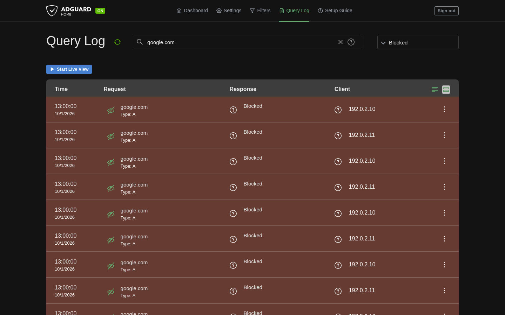
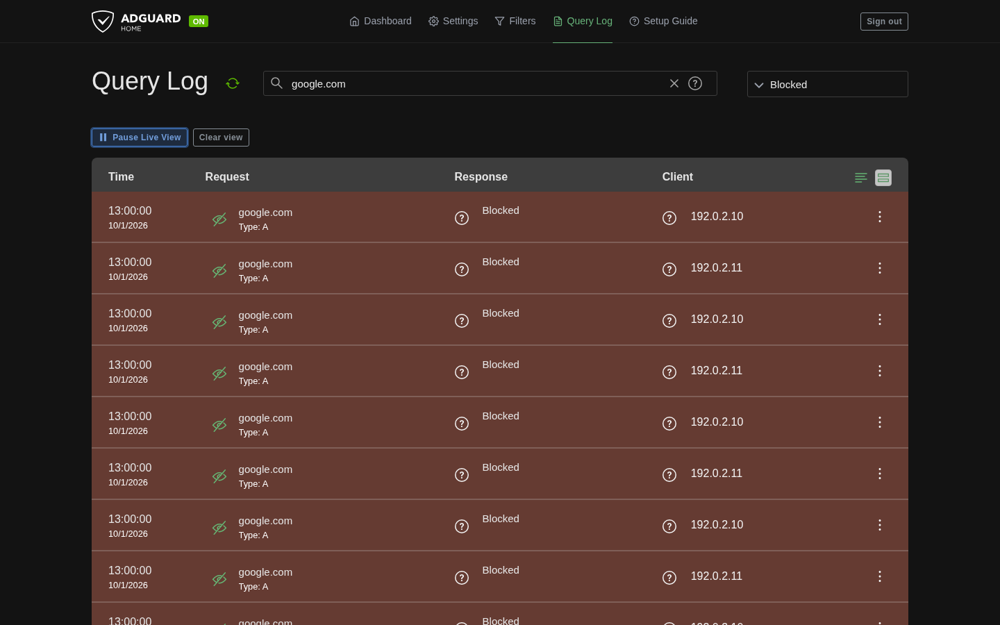
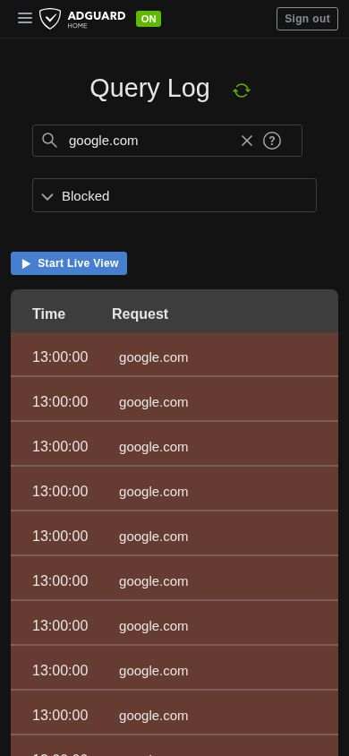
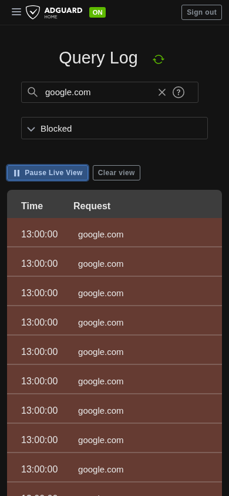
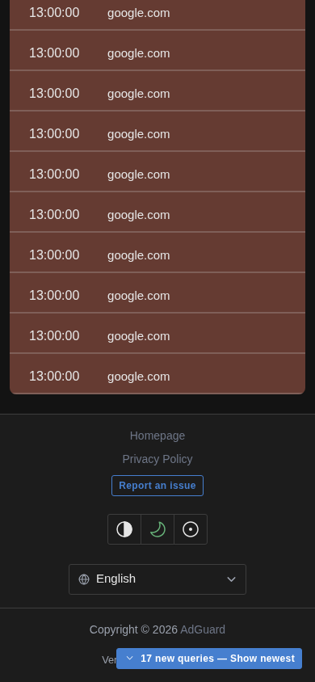

# Live Query Log controls

Click **Start Live View** to enable live polling. The blue start button becomes an outlined **Pause Live View** action; **Clear view** appears beside it as a secondary action. Clearing affects only the displayed browser view and keeps AdGuard Home's server Query Log/history, as explained by the button's tooltip and screen-reader description.

While reading older rows, new arrivals wait behind **17 new queries — Show newest**. Activating it reveals the queued queries and returns to the newest entries. The screenshots use sample blocked queries for `google.com`; the browser fixtures also use `microsoft.com` when validating filter changes.

These are visible-viewport captures of the production frontend from the existing browser harness, with deterministic API fixtures. Desktop is 1440 × 900; mobile is 390 × 844. The harness also checks the same states at 320 × 740, including action names, keyboard focus/activation, spacing, preference persistence, and queued arrivals through client block/unblock.

## Continuity and recovery

Live View still polls once per second after each completed request cycle. Each cycle starts with `GET /control/querylog?limit=100` and the current server filters. It uses only the response's `oldest` value as `older_than` for additional pages; it never combines cursor pagination with `offset`. A full page alone does not trigger backfill: the previous checkpoint must be absent or only partially present. Short or empty filtered pages can still have a continuation cursor and are followed when recovery needs them.

The first successfully processed Live page establishes a baseline for that filter, without fetching historical pages. The checkpoint records the full nanosecond timestamp and occurrence identities of the entire newest observed timestamp group, including a group recovered after an empty first page. Every identity in that group must be observed again to establish overlap; a timestamp comparison or one matching record is insufficient. All recovered pages are merged newest first, using the existing immutable request/response identity and per-page multiplicity to avoid duplicating overlapping reads. Display rows, queued rows and their trimming boundaries are separate from this checkpoint.

Pause/resume, hidden/visible transitions, offline/online events and temporary API failures retain the checkpoint. Hidden or offline tabs suspend requests; returning triggers recovery from the latest page. Requests remain sequential, including through lifecycle changes, and aborted or stale responses cannot modify the current filter, checkpoint or view. A partial API failure retains successfully read rows and the old checkpoint for retry. Retries wait five seconds and show at most one error toast per outage, including when the tab is hidden or Live View is paused during the outage. Changing filters establishes a new baseline and clears the old filter's gap warning. Checkpoints are browser memory only and are not retained across page reloads.

Recovery has hard limits of **100 records per request, 10 requests and 5 seconds per cycle**, including network time. At most 1,000 recovered records are considered in one cycle. The elapsed deadline aborts an outstanding request; no new request starts until that transport settles. On a page/time limit, unusable cursor, expired checkpoint or ambiguous timestamp boundary, recovery reports a gap and accepts the successfully read head as the new boundary. If no records were available to form a new boundary, only the head is probed until a fresh row is observed, with the gap warning retained. This keeps subsequent polling inexpensive instead of restarting the same historical backfill. The warning remains until a new filter/session establishes a baseline; successful HTTP responses, Pause and Clear view do not dismiss it.

The existing retention limits remain **500 displayed rows and 500 pending rows**. The pending number counts retained queued rows, rather than every query in a large burst. Older recovered rows can be intentionally trimmed from this bounded browser view even when continuity was verified.

The small status beside the controls uses a polite, atomic screen-reader status region and text in both themes:

- **Live / Synced:** the initial baseline is established, or all checkpoint identities overlapped within the available API evidence, with no unresolved gap.
- **Catching up:** starting or resuming observation, or retrieving additional pages.
- **Reconnecting:** requests failed or the browser is offline; recovery remains pending.
- **Suspended:** the tab is hidden and polling is suspended automatically.
- **Gap detected:** recovery could not verify continuity. This bordered warning remains visible alongside reconnecting, catching-up or paused status when applicable.
- **Paused:** Live View was intentionally disabled. Existing non-live history pagination remains available.

**Clear view** cancels the current Live cycle and removes only browser rows. It keeps the checkpoint and suppresses all records at or below the newest observed timestamp, including indistinguishable records at the clear boundary. If cleared before any Live baseline is available, the next successful page becomes an empty-view baseline. That intentionally omits arrivals before that baseline, since they cannot be distinguished from cleared history. A new filter or page session starts its own view. Clear view never calls the server clear endpoint, changes server-side history, or alters AdGuard Home's storage.

## API limits

These are best-effort continuity checks, not lossless or exactly-once delivery. The [supported Query Log API](https://github.com/AdguardTeam/AdGuardHome/blob/v0.107.79/openapi/openapi.yaml#L190-L255) has no guaranteed unique query event ID or snapshot token. [`older_than` is strictly exclusive](https://github.com/AdguardTeam/AdGuardHome/blob/v0.107.79/internal/querylog/searchparams.go#L66-L79). A full page ending with a shared timestamp can hide more records at that timestamp, and duplicate frontier identities cannot prove event-level overlap. Both observable cases produce a conservative gap warning. An unseen tie outside a returned page, or substitution of identical records with unchanged multiplicity, cannot always be detected.

AdGuard Home [selects candidates before sorting the response](https://github.com/AdguardTeam/AdGuardHome/blob/v0.107.79/internal/querylog/search.go); this is not a stable globally ordered snapshot. Newly visible or delayed records within fetched pages are merged in timestamp order, including records older than a recognized checkpoint row in that page. Records appearing later behind the fetched overlap or the browser's retained view floor can remain unseen. Arbitrarily delayed visibility, clock changes, log rotation or server history deletion cannot be fully repaired by timestamp pagination. A missing checkpoint produces a warning rather than a claim of synchronisation.

Everything described here is implemented in the frontend patch. The AdGuard Home binary, DNS processing, configuration and server query history are unchanged. No additional service or installation requirement is introduced.

## Desktop, inactive

## Desktop, Live

## Mobile, inactive

## Mobile, Live

## Mobile, queued queries

